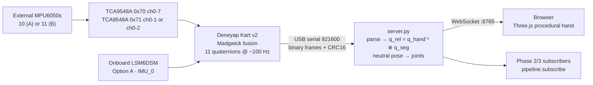
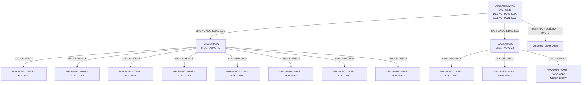

# Deneyap Hand Tracker — Phase 1

Real-time hand motion-capture glove with two interchangeable Deneyap Kart v2
(ESP32-S3) firmware sketches. Both stream the same 11-quaternion binary
protocol over USB serial to the PC bridge and mirrored 3D hand UI:

- `deneyap_hand_tracker`: 11 external MPU6050s on 2x TCA9548A muxes.
- `deneyap_hand_tracker_onboard`: onboard LSM6DSM for IMU_0 plus 10 external
  MPU6050s on the muxes.

Phase 2 (sign-language classifier) and Phase 3 (air mouse) plug into the PC
bridge's pub/sub pipeline — see [Phase 2/3 extension](#phase-23-extension),
nothing in Phase 1 needs to change.

## Data flow



## Visual hardware & hand-placement model

The glove has one reference IMU on the back of the hand and two IMUs along
each finger. “Lower” is the segment nearest the palm; “upper” is nearest the
fingertip.

```text
                                  FINGERTIPS
       THUMB          INDEX         MIDDLE          RING          PINKY
   [IMU_2 upper]  [IMU_4 upper] [IMU_6 upper] [IMU_8 upper] [IMU_10 upper]
        |              |             |              |              |
   [IMU_1 lower]  [IMU_3 lower] [IMU_5 lower] [IMU_7 lower] [IMU_9 lower]
        \______________\____________|______________/______________/
                             PALM / HAND DORSUM
                                   [IMU_0]
                Option A: onboard LSM6DSM  |  Option B: MPU6050
                                      WRIST
```

The following bus diagram shows the physical I2C topology. Each `SDx` is the
channel SDA pin and each `SCx` is its matching channel SCL pin. MPU6050 power
uses the common 3V3/GND rails; the mux switches only the channel SDA/SCL lines.

```text
 Deneyap Kart v2
  3V3 ─────┬──────────────────> Mux 1 VIN
           ├──────────────────> Mux 2 VIN
           └──────────────────> all MPU6050 VCC
  GND ─────┬──────────────────> Mux 1 GND
           ├──────────────────> Mux 2 GND
           └──────────────────> all MPU6050 GND
  D10 / GPIO47 SDA ───────────> Mux 1 SDA + Mux 2 SDA
  D11 / GPIO21 SCL ───────────> Mux 1 SCL + Mux 2 SCL

  TCA9548A #1 (0x70, A0=GND)             TCA9548A #2 (0x71, A0=3V3)
   ch0 SD0/SC0 ───────────────> MPU #1    ch0 SD0/SC0 ─────> MPU #9
   ch1 SD1/SC1 ───────────────> MPU #2    ch1 SD1/SC1 ─────> MPU #10
   ch2 SD2/SC2 ───────────────> MPU #3    ch2 SD2/SC2 ─────> MPU #11 (Option B only)
   ch3 SD3/SC3 ───────────────> MPU #4
   ch4 SD4/SC4 ───────────────> MPU #5    Each MPU6050:
   ch5 SD5/SC5 ───────────────> MPU #6    address 0x68, AD0=GND
   ch6 SD6/SC6 ───────────────> MPU #7
   ch7 SD7/SC7 ───────────────> MPU #8

  MPU #1–#11 are external sensor placeholders; Step 4 maps them to IMU IDs.
  Option A uses Mux 2 ch0–1; Option B also uses Mux 2 ch2.

  Option A only: main I2C bus ─────────────────> onboard LSM6DSM (IMU_0)
  Option B only: Mux 1 ch0 above ──────────────> hand-dorsum MPU6050 (IMU_0)
```



## Directory layout

```
deneyap/
├── README.md
├── .gitignore
├── firmware/
│   ├── deneyap_hand_tracker/
│   │   ├── deneyap_hand_tracker.ino     # ESP32-S3 firmware (Arduino framework)
│   │   └── platformio.ini
│   └── deneyap_hand_tracker_onboard/
│       ├── deneyap_hand_tracker_onboard.ino
│       └── platformio.ini
└── pc_app/
    ├── requirements.txt                 # pyserial, websockets
    ├── protocol.py                      # wire framing + CRC-16/CCITT-FALSE parser
    ├── pose.py                          # quaternion math, relative pose, neutral capture
    ├── server.py                        # serial→WebSocket bridge + HTTP UI (entry point)
    └── web/
        ├── index.html                   # self-contained UI + HUD (no model files)
        └── app.js                       # Three.js renderer, procedural hand
```

## Step-by-step wiring guide

### Step 1 — Common power & main I2C bus

With power disconnected, make these shared connections first:

| From (Deneyap Kart v2) | To | Notes |
|---|---|---|
| 3V3 (3.3 V output) | Mux 1 VIN, Mux 2 VIN, MPU6050 VCC | Use the board's 3.3 V rail |
| GND | Mux 1 GND, Mux 2 GND, MPU6050 GND | Common ground |
| SDA — header **D10**, GPIO47 | Mux 1 SDA, Mux 2 SDA | Main I2C SDA |
| SCL — header **D11**, GPIO21 | Mux 1 SCL, Mux 2 SCL | Main I2C SCL |

The board's 3V3 regulator powers the muxes and IMUs. Do not power an MPU6050
from 5 V.

### Step 2 — Set TCA9548A addresses

Both multiplexers share the main SDA/SCL bus, so their addresses must differ.
Keep A1 and A2 at GND on both boards:

| Multiplexer | A2 | A1 | A0 | I2C address |
|---|---|---|---|---|
| Mux 1 | GND | GND | **GND** | **0x70** |
| Mux 2 | GND | GND | **3V3 (HIGH)** | **0x71** |

Mux 1's A0 stays LOW; set only Mux 2's A0 HIGH. On breakout boards this is
usually a solder jumper or address-pad bridge. An incorrect A0 setting makes
Mux 2 unreachable (`MUX2 (0x71) NOT FOUND`).

### Step 3 — Prepare and connect the MPU6050 modules

Tie **AD0 to GND** on every MPU6050 so its I2C address is `0x68`. Connect
`VCC` to 3V3 and `GND` to common ground. Connect `SDA` and `SCL` to the
assigned mux channel's `SDx` and `SCx` pins respectively (for example,
channel 3 uses `SD3` and `SC3`). Do not connect a muxed sensor's SDA/SCL
directly to the board's main bus.

The TCA9548A switches one selected channel at a time, so muxed MPU6050s can
share address `0x68`. The onboard LSM6DSM in Option A stays on the board's
main I2C bus and is not connected through either mux.

### Step 4 — Choose a firmware option and follow its channel map

#### Option A — Recommended: onboard LSM6DSM + 10 external MPU6050s

Open `firmware/deneyap_hand_tracker_onboard`. The board's onboard LSM6DSM is
`IMU_0` on the hand dorsum. Attach the ten external MPU6050s as follows:

| IMU | Multiplexer channel | Hand placement |
|---|---|---|
| IMU_1 / IMU_2 | Mux 1 ch0 / ch1 | Thumb lower / upper |
| IMU_3 / IMU_4 | Mux 1 ch2 / ch3 | Index lower / upper |
| IMU_5 / IMU_6 | Mux 1 ch4 / ch5 | Middle lower / upper |
| IMU_7 / IMU_8 | Mux 1 ch6 / ch7 | Ring lower / upper |
| IMU_9 / IMU_10 | Mux 2 ch0 / ch1 | Pinky lower / upper |

#### Option B: 11 external MPU6050s

Open `firmware/deneyap_hand_tracker`. All sensors, including `IMU_0` on the
hand dorsum, are MPU6050s behind the muxes:

| IMU | Multiplexer channel | Hand placement |
|---|---|---|
| IMU_0 | Mux 1 ch0 | Hand dorsum (global reference) |
| IMU_1 / IMU_2 | Mux 1 ch1 / ch2 | Thumb lower / upper |
| IMU_3 / IMU_4 | Mux 1 ch3 / ch4 | Index lower / upper |
| IMU_5 / IMU_6 | Mux 1 ch5 / ch6 | Middle lower / upper |
| IMU_7 / IMU_8 | Mux 1 ch7 / Mux 2 ch0 | Ring lower / upper |
| IMU_9 / IMU_10 | Mux 2 ch1 / ch2 | Pinky lower / upper |

### Important hardware notes

- Keep I2C wires shorter than **20 cm** and route SDA/SCL together when
  possible. A 400 kHz bus needs clean wiring.
- MPU6050 breakouts often have pull-up resistors. If the bus is noisy or
  frames fail CRC, remove extra parallel pull-ups or lower
  `I2C_CLK_HZ` to `100000UL` in the chosen sketch's source.
- Do not use the SD-card pins **D27–D29** for this wiring.

## Firmware

### PlatformIO

```bash
cd ~/<Documents>/deneyap/firmware/deneyap_hand_tracker_onboard
pio run -t upload
```

This recommended setup uses the onboard LSM6DSM plus ten external MPU6050s.
For 11 external MPU6050s, use `firmware/deneyap_hand_tracker` instead; both
folders contain a matching standalone sketch and `platformio.ini`.

The project pins the exact Deneyap Kart v2 configuration (8 MB flash, OPI
PSRAM, USB Mode = Hardware CDC and JTAG, CDC On Boot = Enabled). PlatformIO
has no native board entry for the Kart v2 yet, so it builds against
`esp32-s3-devkitc-1` with those flags. `pio device monitor` shows the human-
readable CAL/RATE log frames (pose frames are binary; the bridge interprets
them).

### Arduino IDE

1. File → Preferences → Additional boards manager URLs:
   `https://raw.githubusercontent.com/deneyapkart/deneyapkart-arduino-core/master/package_deneyapkart_index.json`
2. Boards Manager → install **Deneyap Gelistirme Kartlari**.
3. Open either sketch from its matching firmware folder, select board
   **Deneyap Kart v2** (USB Mode: Hardware CDC and JTAG, USB CDC On Boot:
   Enabled — both are the defaults), and upload.

No driver needed on Linux; the board enumerates as `/dev/ttyACM0`
(USB-Serial-JTAG — baud rate is ignored by the hardware, `921600` is kept for
registers/bridges on other boards).

## PC bridge

```bash
cd ~/<Documents>/deneyap/pc_app
python3 -m venv .venv && source .venv/bin/activate
pip install -r requirements.txt

python3 server.py --sim      # demo mode, no hardware: animated synthetic hand
python3 server.py            # hardware: auto-detects the serial port
python3 server.py --port /dev/ttyACM0 --list-ports
```

Then open **http://localhost:8080** in a browser. The UI is served by the
bridge itself (WebSocket on :8765). Keep the tab open; the hand mirrors the
glove at 60 FPS.

Phase 1 UI controls:

- **Zero / Calibrate Hand** (or press **C**) captures the current neutral pose.
- Expand **Drift & Deadzone** to tune the angular deadzone for one IMU or all
  IMUs, view live angular jitter, or reset the thresholds.
- Under **Board Orientation**, choose USB direction (`180°`, `0°`, `90°`, or
  `270°`) and optionally invert yaw, roll, or pitch to match the board mount.

| Option | Default | Meaning |
|---|---|---|
| `--sim` | off | synthetic IMU stream (dev/demo) |
| `--port` | auto | serial device; auto-detect prefers ttyACM |
| `--baud` | 921600 | serial baud (USB-Serial-JTAG ignores it) |
| `--ws-port` / `--ws-host` | 8765 / 127.0.0.1 | WebSocket endpoint |
| `--http-port` / `--http-host` | 8080 / 127.0.0.1 | UI endpoint |
| `--no-auto-zero` | off | don't capture neutral pose on first frame |

Environment overrides: `DENEYAP_SERIAL_PORT`, `DENEYAP_BAUD`, `DENEYAP_WS_PORT`,
`DENEYAP_HTTP_PORT`, `DENEYAP_HOST`.

## Calibration procedure

1. Power everything, plug in the USB cable — the firmware calibrates at boot
   (≈1–2 s per step; watch the bridge log for `CAL IMU_x ok` lines and
   `CALIB_DONE good=11/11`).
2. Wear the glove, hold the hand **flat and relaxed, palm down or level,
   fingers straight** — that posture is the neutral (zero) pose.
3. Press **Zero / Calibrate Hand** in the UI (or press **C**). The HUD shows
   `neutral: captured …`.
4. Sanity check: rotate the whole hand — the palm rotates, fingers stay
   straight. Bend a finger — only that finger moves. The neutral pose is
   re-pinned any time with the same button.

The neutral capture absorbs every per-segment mounting offset, so the IMUs
do not need to be aligned with the glove segments.

## Wire protocol (firmware ⇄ bridge)

```
A5 5A | type | seq | len | payload… | crc_lo | crc_hi      (CRC-16/CCITT-FALSE, poly 0x1021)
type 0x01 pose : flags | status_lo | status_hi | 11× quat[w,x,y,z] as int16 Q15
type 0x02 log  : ASCII
```

See the header comment of `deneyap_hand_tracker.ino` and `protocol.py`.

Known limit: MPU6050 has no magnetometer, so the **absolute yaw** of the
hand drifts slowly (gyro integration). Finger bending and pitch/roll are
gravity-corrected and stable. Re-zero occasionally; a BNO055/MPU9250 driver
with the same `begin()/readRaw()` contract replaces the MPU6050 class
without touching anything else.

## Phase 2/3 extension

```python
# in pc_app/server.py main(), after `pipeline = Pipeline(...)`:
async def sign_language_module(pose):
    """Gets every processed pose exactly like the UI."""
    joints = pose["joints"]          # neutral-corrected, hand frame
    segs   = pose["segments"]        # raw relative quaternions, hand frame
    hand   = pose["hand"]["q"]       # world orientation of the palm
    health = pose["health"]          # per-IMU status
    ...                              # ML inference, cursor mapping, …

pipeline.subscribe("phase2_gestures", sign_language_module)
```

Subscribers may be plain functions or coroutines; exceptions are caught and
logged, and never break the stream.

## Troubleshooting

| Symptom | Cause / fix |
|---|---|
| `MUX2 (0x71) NOT FOUND` | A0 pull-up/jumper missing on the second mux |
| `CAL IMU_n FAILED` | wiring on that channel (SDA/SCL crossed, no power), or AD0 not low |
| `poorly healthy` count / bad-crc growing | bus integrity: shorten wires, remove extra pull-ups, drop `I2C_CLK_HZ` to 100 kHz |
| No serial port found | board not in USB CDC mode (upload a sketch with CDC on boot), cable, `--list-ports` |
| `Permission denied` on /dev/ttyACM0 | add user to `dialout` group (sudo usermod -aG dialout $USER), re-login |
| UI shows OFFLINE | bridge not running, or click Zero after a reconnect |
| Finger bends when the whole hand rotates | only if neutral was captured while moving — re-zero with the hand still |
