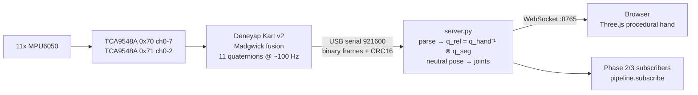

# Deneyap Hand Tracker — Phase 1

Real-time hand motion-capture glove: 11x MPU6050 on 2x TCA9548A I2C muxes,
fused on a Deneyap Kart v2 (ESP32-S3), streamed over USB serial to a PC that
renders a mirrored 3D hand in the browser.

Phase 2 (sign-language classifier) and Phase 3 (air mouse) plug into the PC
bridge's pub/sub pipeline — see [Phase 2/3 extension](#phase-23-extension),
nothing in Phase 1 needs to change.

## Data flow



## Directory layout

```
deneyap/
├── README.md
├── firmware/
│   └── deneyap_hand_tracker/
│       ├── deneyap_hand_tracker.ino     # ESP32-S3 firmware (Arduino framework)
│       └── platformio.ini
└── pc_app/
    ├── requirements.txt                 # pyserial, websockets
    ├── protocol.py                      # wire framing + CRC-16/CCITT-FALSE parser
    ├── pose.py                          # quaternion math, relative pose, neutral capture
    ├── server.py                        # serial→WebSocket bridge + HTTP UI (entry point)
    └── web/
        ├── index.html                   # self-contained UI + HUD (no model files)
        └── app.js                       # Three.js renderer, procedural hand
```

## Wiring checklist

Power and bus first — both muxes and all 11 IMUs share one I2C bus:

| From (Deneyap Kart v2) | To | Notes |
|---|---|---|
| 3V3 (3.3 V output) | Mux1 VIN, Mux2 VIN | also VCC of every IMU module |
| GND | Mux1 GND, Mux2 GND | common ground everywhere |
| SDA — header **D10**, GPIO 47 | Mux1 SDA, Mux2 SDA | onboard 10 kΩ pull-ups exist |
| SCL — header **D11**, GPIO 21 | Mux1 SCL, Mux2 SCL | |

> Only one 3V3 supply is needed: the board's regulator handles ~11 IMUs
> (~45 mA) plus both muxes easily.

**TCA9548A address pins (critical):**

| Mux | A2 | A1 | A0 | I2C address | Channels used |
|---|---|---|---|---|---|
| Mux 1 | GND | GND | GND | **0x70** | 0–7 (IMU_0..IMU_7) |
| Mux 2 | GND | GND | **3V3 (HIGH)** | **0x71** | 0–2 (IMU_8..IMU_10) |

A0 HIGH is the only soldered/jumpered difference between the two muxes. If
they are bought as breakout modules with A0–A2 jumper pads, set A0 on mux 2
only. Wrong A0 → the second mux is unreachable (firmware logs
`MUX2 (0x71) NOT FOUND`).

**IMU modules (all AD0 → GND, all I2C address 0x68 — the mux isolates them,**
so same addresses are fine; module SDA/SCL go to the channel pins of their mux):

| IMU | Mux / channel | Body part |
|---|---|---|
| IMU_0 | Mux1 ch0 | hand dorsum (global reference) |
| IMU_1 / IMU_2 | Mux1 ch1 / ch2 | thumb lower / upper |
| IMU_3 / IMU_4 | Mux1 ch3 / ch4 | index lower / upper |
| IMU_5 / IMU_6 | Mux1 ch5 / ch6 | middle lower / upper |
| IMU_7 / IMU_8 | Mux1 ch7 / **Mux2 ch0** | ring lower / upper |
| IMU_9 / IMU_10 | Mux2 ch1 / ch2 | pinky lower / upper |

Each mux channel has SDx/SCx pins; only one channel is live at a time (the
TCA9548A latches it), so all downstream devices can share address 0x68.

Tips:

- Keep wires < 20 cm and pair SDA/SCL if possible; **400 kHz needs a clean bus**.
- IMU breakout boards usually carry their own pull-ups: with 11 modules the
  parallel pull-up becomes too strong only on the selected channel — if I2C
  errors appear (bad-crc growth in the bridge log), remove the pull-up
  resistors from all but one module (the board's 10 kΩ SDA/SCL pull-ups
  already cover the bus), or set `I2C_CLK_HZ` to `100000UL` in the firmware.
- The board also has an onboard LSM6DSM IMU on the same lines (address
  0x6A/0x6B) — it never conflicts with 0x68/0x70/0x71; leave it alone.
- **Do not** plug anything into the SD-card pins (D27–D29 are not usable).

## Firmware

### PlatformIO

```bash
cd ~/<Documents>/deneyap/firmware/deneyap_hand_tracker   # e.g. ~/Belgeler/deneyap/...
pio run -t upload
```

The project pins the exact Deneyap Kart v2 configuration (8 MB flash, OPI
PSRAM, USB Mode = Hardware CDC and JTAG, CDC On Boot = Enabled). PlatformIO
has no native board entry for the Kart v2 yet, so it builds against
`esp32-s3-devkitc-1` with those flags. `pio device monitor` shows the human-
readable CAL/RATE log frames (pose frames are binary; the bridge interprets
them).

### Arduino IDE

1. File → Preferences → Additional boards manager URLs:
   `https://raw.githubusercontent.com/deneyapkart/deneyapkart-arduino-core/master/package_deneyapkart_index.json`
2. Boards Manager → install **Deneyap Gelistirme Kartlari**.
3. Open `deneyap_hand_tracker.ino`, select board **Deneyap Kart v2**
   (USB Mode: Hardware CDC and JTAG, USB CDC On Boot: Enabled — both are the
   defaults), upload.

No driver needed on Linux; the board enumerates as `/dev/ttyACM0`
(USB-Serial-JTAG — baud rate is ignored by the hardware, `921600` is kept for
registers/bridges on other boards).

## PC bridge

```bash
cd ~/<Documents>/deneyap/pc_app
python3 -m venv .venv && source .venv/bin/activate
pip install -r requirements.txt

python3 server.py --sim      # demo mode, no hardware: animated synthetic hand
python3 server.py            # hardware: auto-detects the serial port
python3 server.py --port /dev/ttyACM0 --list-ports
```

Then open **http://localhost:8080** in a browser. The UI is served by the
bridge itself (WebSocket on :8765). Keep the tab open; the hand mirrors the
glove at 60 FPS.

| Option | Default | Meaning |
|---|---|---|
| `--sim` | off | synthetic IMU stream (dev/demo) |
| `--port` | auto | serial device; auto-detect prefers ttyACM |
| `--baud` | 921600 | serial baud (USB-Serial-JTAG ignores it) |
| `--ws-port` / `--ws-host` | 8765 / 127.0.0.1 | WebSocket endpoint |
| `--http-port` / `--http-host` | 8080 / 127.0.0.1 | UI endpoint |
| `--no-auto-zero` | off | don't capture neutral pose on first frame |

Environment overrides: `DENEYAP_SERIAL_PORT`, `DENEYAP_BAUD`, `DENEYAP_WS_PORT`,
`DENEYAP_HTTP_PORT`, `DENEYAP_HOST`.

## Calibration procedure

1. Power everything, plug in the USB cable — the firmware calibrates at boot
   (≈1–2 s per step; watch the bridge log for `CAL IMU_x ok` lines and
   `CALIB_DONE good=11/11`).
2. Wear the glove, hold the hand **flat and relaxed, palm down or level,
   fingers straight** — that posture is the neutral (zero) pose.
3. Press **Zero / Calibrate Hand** in the UI (or press **C**). The HUD shows
   `neutral: captured …`.
4. Sanity check: rotate the whole hand — the palm rotates, fingers stay
   straight. Bend a finger — only that finger moves. The neutral pose is
   re-pinned any time with the same button.

The neutral capture absorbs every per-segment mounting offset, so the IMUs
do not need to be aligned with the glove segments.

## Wire protocol (firmware ⇄ bridge)

```
A5 5A | type | seq | len | payload… | crc_lo | crc_hi      (CRC-16/CCITT-FALSE, poly 0x1021)
type 0x01 pose : flags | status_lo | status_hi | 11× quat[w,x,y,z] as int16 Q15
type 0x02 log  : ASCII
```

See the header comment of `deneyap_hand_tracker.ino` and `protocol.py`.

Known limit: MPU6050 has no magnetometer, so the **absolute yaw** of the
hand drifts slowly (gyro integration). Finger bending and pitch/roll are
gravity-corrected and stable. Re-zero occasionally; a BNO055/MPU9250 driver
with the same `begin()/readRaw()` contract replaces the MPU6050 class
without touching anything else.

## Phase 2/3 extension

```python
# in pc_app/server.py main(), after `pipeline = Pipeline(...)`:
async def sign_language_module(pose):
    """Gets every processed pose exactly like the UI."""
    joints = pose["joints"]          # neutral-corrected, hand frame
    segs   = pose["segments"]        # raw relative quaternions, hand frame
    hand   = pose["hand"]["q"]       # world orientation of the palm
    health = pose["health"]          # per-IMU status
    ...                              # ML inference, cursor mapping, …

pipeline.subscribe("phase2_gestures", sign_language_module)
```

Subscribers may be plain functions or coroutines; exceptions are caught and
logged, and never break the stream.

## Troubleshooting

| Symptom | Cause / fix |
|---|---|
| `MUX2 (0x71) NOT FOUND` | A0 pull-up/jumper missing on the second mux |
| `CAL IMU_n FAILED` | wiring on that channel (SDA/SCL crossed, no power), or AD0 not low |
| `poorly healthy` count / bad-crc growing | bus integrity: shorten wires, remove extra pull-ups, drop `I2C_CLK_HZ` to 100 kHz |
| No serial port found | board not in USB CDC mode (upload a sketch with CDC on boot), cable, `--list-ports` |
| `Permission denied` on /dev/ttyACM0 | add user to `dialout` group (sudo usermod -aG dialout $USER), re-login |
| UI shows OFFLINE | bridge not running, or click Zero after a reconnect |
| Finger bends when the whole hand rotates | only if neutral was captured while moving — re-zero with the hand still |
